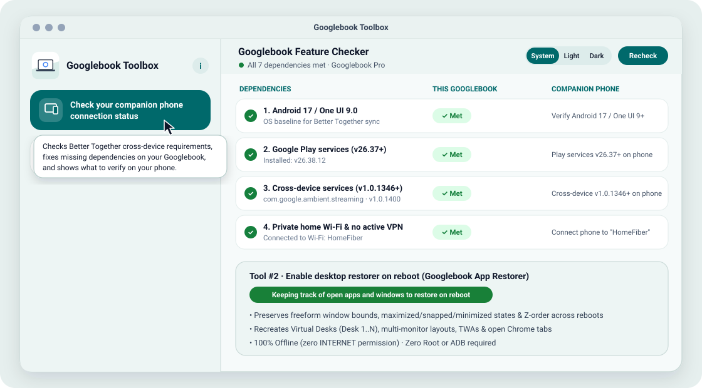
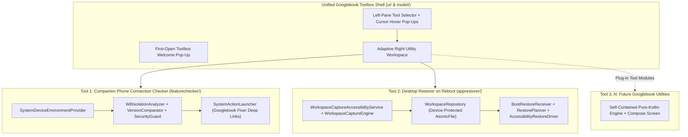

<p align="center">
  
</p>

<h1 align="center">Googlebook Toolbox</h1>

<p align="center">
  <b>A growing toolbox of useful tools and utilities to supercharge your Googlebook usage.</b><br>
  One unified, extensible desktop app bringing together power-user workflows, cross-device diagnostics, and productivity utilities built specifically for Googlebooks — <b>100% offline, with zero root or ADB required</b>.
</p>

<p align="center">
  <a href="../../releases/latest/download/GooglebookToolbox-release.apk"><b>⬇ Download GooglebookToolbox-release.apk</b></a>
  &nbsp;·&nbsp; <a href="#why-googlebook-toolbox">Why Googlebook Toolbox</a>
  &nbsp;·&nbsp; <a href="#current-tools--roadmap">Tools &amp; Roadmap</a>
  &nbsp;·&nbsp; <a href="#quick-start">Quick Start</a>
  &nbsp;·&nbsp; <a href="#permissions--100-offline-privacy">Permissions &amp; Privacy</a>
  &nbsp;·&nbsp; <a href="#extensible-architecture">Architecture</a>
  &nbsp;·&nbsp; <a href="#testing-fuzzing--security-verification">Testing &amp; Fuzzing</a>
  &nbsp;·&nbsp; <a href="#license">License</a>
</p>

<p align="center">
  
  
  
  
  
  
</p>

<p align="center">
  <sub>An open-source passion project, proudly developed on and for a Googlebook in its Linux Terminal.<br>
  Not affiliated with or endorsed by Google or any employer (<a href="#about-this-project">more</a>).</sub>
</p>

---

## Why Googlebook Toolbox?

Instead of installing a dozen separate single-purpose helper apps, **Googlebook Toolbox** gives your Googlebook a single, cohesive home for practical utilities that solve everyday desktop pain points, unlock hidden capabilities, and streamline how you work.

- **Built to Grow**: Designed around a modular two-pane studio shell (`ToolboxDestination` + self-contained Kotlin tool packages) so new Googlebook utilities can be added seamlessly over time.
- **Clean, Distraction-Free Desktop UX**:
  - **First-Open Welcome Pop-Up**: Introduces the app as your all-in-one Googlebook utility belt (accessible anytime via the `i` icon).
  - **Streamlined Left-Pane Launcher + Cursor Hover Pop-Ups**: Keeps the sidebar crisp with concise tool titles and surfaces rich hover descriptions whenever you rest your cursor over an option.
  - **Full-Width Utility Workspace**: Opens the active tool directly in the right pane, scaling smoothly from wide multi-monitor Googlebook setups (`>= 600dp`) down to compact viewports (`< 600dp`).
- **Privacy-First by Design**: Operates **100% offline** (zero `INTERNET` permission) using only standard, user-grantable Android SDK APIs — never requiring root or ADB.

<p align="center">
  
</p>

---

## Current Tools & Roadmap

The two utilities shipping today are **just the beginning** — originally proven as standalone community tools ([Googlebook Feature Checker](https://github.com/parijat-star/GooglebookFeatureChecker) and [Googlebook App Restorer](https://github.com/parijat-star/GooglebookAppRestorer)) and now unified inside **Googlebook Toolbox** alongside an expanding roadmap of future Googlebook utilities.

### Tool 1 · Check your companion phone connection status
Tracks **Better Together** cross-device prerequisites step by step, fixes missing dependencies **on your Googlebook**, and clearly lists what to verify on your companion Android phone:

| Step | Dependency | Googlebook Verification & Fixer | Companion Phone Check |
| :--- | :--- | :--- | :--- |
| **1** | **Android 17 / One UI 9.0** | Verifies Android 17 (`API 37` / release `17`) baseline (`System Update` deep link if unmet). | Verify Android 17 / Samsung One UI `9.0+` |
| **2** | **Google Play services (`v26.37+`)** | Inspects `com.google.android.gms` version and deep-links to `Update Apk` when outdated. | Verify Play services `v26.37+` |
| **3** | **Cross-device services (`v1.0.1346+`)** | Inspects `com.google.ambient.streaming` version (`Update Apk` fixer button). | Verify Cross-device services `v1.0.1346+` |
| **4** | **Private home Wi-Fi & no active VPN** | Displays connected Wi-Fi SSID and runs 9 AP host-isolation, captive-portal, enterprise 802.1X/Passpoint, subnet, and VPN heuristics (`Wifi Not Supported` alert when isolated). | Connect phone to the same private home Wi-Fi |
| **5** | **Bluetooth turned on** | Checks local Bluetooth adapter state (`Enable Bluetooth` deep link). | Turn Bluetooth ON on phone |
| **6** | **Same Google account & 'Continue activity'** | Deep-links to Cross-device services settings to enable *Tasks*, *Apps*, *Notifications*, and *Files & media*. | Sign into same Google account & enable *Continue activity* |
| **7** | **Matching device build type (`user` / `userdbg`)** | Inspects `android.os.Build.TYPE` (`View Build Info` deep link). | Ensure phone runs matching `user` or `userdbg` build |

Includes full keyboard shortcuts (`↑`/`↓`, `Space`/`Enter` click-marks, `R` recheck, `T` theme cycle `System → Light → Dark`, `F` diagnostic report copy & Google Feedback launch).

---

### Tool 2 · Enable desktop restorer on reboot
Keeps track of your open apps, desktop windows, Virtual Desks, displays, and Chrome tabs so your workspace picks up right where you left off after every reboot:

- **Always-On Background Tracking**: Continues tracking open apps and windows even when the Toolbox window is closed (`"Keeping track of open apps and windows to restore on reboot"`), flushing atomically (`AtomicFile` + `fsync`) to Device-Protected Storage on Power Menu, screen-off, and shutdown.
- **Multi-Desk & Multi-Display Fidelity (Schema v6)**:
  - Tracks windows across `Desk 1..N` and connected external monitors (`DisplayManager` + `WindowMetrics`).
  - Automatically recreates missing Virtual Desks in Overview on reboot, activates each desk in sequence, and scales window bounds proportionally if an external monitor was unplugged.
- **Exact Window Geometry, Z-Order & Minimized State**:
  - Restores exact pixel bounds and states (`FREEFORM`, `MAXIMIZED`, `FULLSCREEN`, `SNAPPED_LEFT`, `SNAPPED_RIGHT`, `MINIMIZED`) and Z-order stacking.
- **TWAs, Multi-Instance Windows & Chrome Tabs**:
  - Distinguishes standalone TWAs / WebAPKs and Gemini from Chrome browser windows, preserves multiple Chrome and Files (`DocumentsUI`) windows, and reconciles open Chrome tab URLs with zero duplicates.
- **Cancelable 6-Second Auto-Restore Pop-Up on Unlock**:
  - Waits until `KeyguardManager` confirms the desktop is unlocked after reboot, then presents a compact centered 6-second countdown (**Cancel** / `Esc`, **Restore now**, or **Choose…**).

---

### Upcoming & Future Toolbox Utilities
**Googlebook Toolbox** is actively expanding! Future releases are planned to add more Googlebook-focused tools — such as additional feature readiness checkers, multi-monitor & peripheral helpers, keyboard/trackpad workflow enhancers, Linux Terminal developer utilities, and system health diagnostics. Have an idea for a tool that would supercharge your Googlebook? [Open a feature request](../../issues) or check [CONTRIBUTING.md](CONTRIBUTING.md) to add a new tool module!

---

## Quick Start

1. **Install the APK**: Download [`GooglebookToolbox-release.apk`](../../releases/latest/download/GooglebookToolbox-release.apk) (or build from source below).
2. **Pick Any Tool in the Left Pane**:
   - Hover over any tool in the left pane to preview what it does, or click to open its workspace on the right.
   - Permissions are **only requested when needed by a specific tool** (for example, optional Wi-Fi SSID Location access for Step #4 in the Companion Phone Connection Checker, or the guided 4-step setup inside Desktop Restorer on Reboot).
   - *Note for sideloaded APKs on Android 13+*: Before enabling Accessibility for Desktop Restorer, open **Settings → Apps → Googlebook Toolbox → ⋮ → Allow restricted settings** once.

---

## Permissions & 100% Offline Privacy

**Googlebook Toolbox requests ZERO network permissions (`no android.permission.INTERNET`).** Every diagnostic check and workspace snapshot stays strictly on your Googlebook.

| Permission | Used By | Purpose |
| :--- | :--- | :--- |
| `ACCESS_NETWORK_STATE` & `ACCESS_WIFI_STATE` | Companion Phone Connection Checker | Inspects local Wi-Fi transport, VPN state, and AP host-isolation telemetry offline. |
| `ACCESS_FINE_LOCATION` *(optional runtime)* | Companion Phone Connection Checker | Required by Android 12+ solely to display the connected Wi-Fi SSID name in Step #4. |
| `BLUETOOTH` | Companion Phone Connection Checker | Checks whether the local Bluetooth adapter is turned on for proximity discovery. |
| `BIND_ACCESSIBILITY_SERVICE` *(optional setup)* | Desktop Restorer on Reboot | Observes desktop window bounds, Virtual Desks in Overview, and Chrome's top-level tab strip/omnibox (skipping `WebView` page DOMs and password nodes), and recreates Virtual Desks on restore. |
| `SYSTEM_ALERT_WINDOW` *(optional setup)* | Desktop Restorer on Reboot | Displays the post-reboot 6-second countdown card after unlock and permits multi-window desktop launches. |
| `PACKAGE_USAGE_STATS` *(optional setup)* | Desktop Restorer on Reboot | Distinguishes minimized vs. closed windows when a single window is occluded. |
| `POST_NOTIFICATIONS` & `RECEIVE_BOOT_COMPLETED` | Desktop Restorer on Reboot | Shows the quiet ongoing background-tracking indicator and promotes the saved snapshot on reboot. |

---

## Extensible Architecture

Each utility in **Googlebook Toolbox** lives in its own isolated Kotlin package and plugs into the shared two-pane Material 3 shell (`GooglebookToolboxApp` + `ToolboxDestination`), making it straightforward to ship new tools without coupling unrelated features:



### Module Layout

| Package | Responsibility |
| :--- | :--- |
| [`ui/`](app/src/main/kotlin/com/droid/googlebooktoolbox/ui) & [`model/`](app/src/main/kotlin/com/droid/googlebooktoolbox/model) | Unified [`GooglebookToolboxApp`](app/src/main/kotlin/com/droid/googlebooktoolbox/ui/GooglebookToolboxApp.kt) two-pane shell, cursor-hover pop-ups, [`GooglebookToolboxLogo`](app/src/main/kotlin/com/droid/googlebooktoolbox/ui/GooglebookToolboxLogo.kt), first-open [`ToolboxWelcomeDialog`](app/src/main/kotlin/com/droid/googlebooktoolbox/ui/GooglebookToolboxApp.kt), and [`ToolboxViewModel`](app/src/main/kotlin/com/droid/googlebooktoolbox/ui/ToolboxViewModel.kt) |
| [`featurechecker/`](app/src/main/kotlin/com/droid/googlebooktoolbox/featurechecker) | 7-step Better Together checklist ([`FeatureCheckerViewModel`](app/src/main/kotlin/com/droid/googlebooktoolbox/featurechecker/ui/FeatureCheckerViewModel.kt), [`FeatureCheckerScreen`](app/src/main/kotlin/com/droid/googlebooktoolbox/featurechecker/ui/FeatureCheckerScreen.kt)), [`WifiIsolationAnalyzer`](app/src/main/kotlin/com/droid/googlebooktoolbox/featurechecker/util/WifiIsolationAnalyzer.kt), [`VersionComparator`](app/src/main/kotlin/com/droid/googlebooktoolbox/featurechecker/util/VersionComparator.kt), [`SecurityGuard`](app/src/main/kotlin/com/droid/googlebooktoolbox/featurechecker/util/SecurityGuard.kt), and [`SystemActionLauncher`](app/src/main/kotlin/com/droid/googlebooktoolbox/featurechecker/util/SystemActionLauncher.kt) |
| [`apprestorer/capture/`](app/src/main/kotlin/com/droid/googlebooktoolbox/apprestorer/capture) & [`inspect/`](app/src/main/kotlin/com/droid/googlebooktoolbox/apprestorer/inspect) | Pure-Kotlin [`WorkspaceCaptureEngine`](app/src/main/kotlin/com/droid/googlebooktoolbox/apprestorer/capture/WorkspaceCaptureEngine.kt), [`WindowGeometryClassifier`](app/src/main/kotlin/com/droid/googlebooktoolbox/apprestorer/capture/WindowGeometryClassifier.kt), [`OverviewDeskInspector`](app/src/main/kotlin/com/droid/googlebooktoolbox/apprestorer/inspect/OverviewDeskInspector.kt), and [`TwaAndBrowserInspector`](app/src/main/kotlin/com/droid/googlebooktoolbox/apprestorer/inspect/TwaAndBrowserInspector.kt) |
| [`apprestorer/data/`](app/src/main/kotlin/com/droid/googlebooktoolbox/apprestorer/data), [`boot/`](app/src/main/kotlin/com/droid/googlebooktoolbox/apprestorer/boot) & [`restore/`](app/src/main/kotlin/com/droid/googlebooktoolbox/apprestorer/restore) | Schema v6 [`WorkspaceRepository`](app/src/main/kotlin/com/droid/googlebooktoolbox/apprestorer/data/WorkspaceRepository.kt), [`BootRestoreReceiver`](app/src/main/kotlin/com/droid/googlebooktoolbox/apprestorer/boot/BootRestoreReceiver.kt), [`BootCountdownOverlay`](app/src/main/kotlin/com/droid/googlebooktoolbox/apprestorer/boot/BootCountdownOverlay.kt), [`RestorePlanner`](app/src/main/kotlin/com/droid/googlebooktoolbox/apprestorer/restore/RestorePlanner.kt), [`TabReconciler`](app/src/main/kotlin/com/droid/googlebooktoolbox/apprestorer/restore/RestoreDrivers.kt), and [`AccessibilityRestoreDriver`](app/src/main/kotlin/com/droid/googlebooktoolbox/apprestorer/restore/RestoreDrivers.kt) |

---

## Testing, Fuzzing & Security Verification

### Prerequisites
- **JDK 17+**
- **Android SDK** (`compileSdk = 36`, `minSdk = 33`)

### Build & Verify Commands

```bash
# Run all 93 unit, Robolectric Compose UI, SDK integration, security, and fuzzing tests:
./gradlew testDebugUnitTest

# Run Android Lint static analysis:
./gradlew lintDebug

# Assemble Debug & R8-minified Release APKs:
./gradlew assembleDebug assembleRelease
```

### Automated Test & Fuzz Suites (`app/src/test/`)

- [`ToolboxViewModelTest`](app/src/test/kotlin/com/droid/googlebooktoolbox/ToolboxViewModelTest.kt) & [`ToolboxScreenTest`](app/src/test/kotlin/com/droid/googlebooktoolbox/ToolboxScreenTest.kt): First-launch welcome dialog persistence, two-pane tool switching, cursor hover pop-up appearance/dismissal, and notification deep-link routing.
- [`ToolboxSecurityAndFuzzTest`](app/src/test/kotlin/com/droid/googlebooktoolbox/ToolboxSecurityAndFuzzTest.kt): Merged `AndroidManifest` audit (enforcing **zero `INTERNET` permission**, `allowBackup="false"`, unexported internal components, `BIND_ACCESSIBILITY_SERVICE`, and protected-broadcast gating), restore-time URI/package injection blocking, `BadParcelableException` Intent DoS protection, compact `< 600dp` viewport verification, and `2,500+` randomized Intent/ViewModel fuzz iterations.
- [`FeatureCheckerViewModelTest`](app/src/test/kotlin/com/droid/googlebooktoolbox/featurechecker/FeatureCheckerViewModelTest.kt), [`FeatureCheckerScreenTest`](app/src/test/kotlin/com/droid/googlebooktoolbox/featurechecker/FeatureCheckerScreenTest.kt) & [`FuzzAndSecurityTest`](app/src/test/kotlin/com/droid/googlebooktoolbox/featurechecker/FuzzAndSecurityTest.kt): All 7 Better Together dependency checks, Wi-Fi host-isolation heuristics, SSRF/URI/package injection blocks, bounded stream readers, and `1,500+` version/JSON fuzz iterations.
- [`WorkspaceSnapshotAndGeometryTest`](app/src/test/kotlin/com/droid/googlebooktoolbox/apprestorer/WorkspaceSnapshotAndGeometryTest.kt), [`WorkspaceRestorerAndUiTest`](app/src/test/kotlin/com/droid/googlebooktoolbox/apprestorer/WorkspaceRestorerAndUiTest.kt), [`PlatformAndBootIntegrationTest`](app/src/test/kotlin/com/droid/googlebooktoolbox/apprestorer/PlatformAndBootIntegrationTest.kt) & [`WorkspaceFuzzAndPropertyTest`](app/src/test/kotlin/com/droid/googlebooktoolbox/apprestorer/WorkspaceFuzzAndPropertyTest.kt): Multi-desk/multi-display capture & restore ordering, Chrome tab deduplication, keyguard-gated boot countdown overlay, and `10,000+` deterministic fuzz iterations across codecs, `BootToken`, URL scheme normalization, deep UI trees, and state-machine invariants.

See [SECURITY.md](SECURITY.md) for the full threat model and vulnerability disclosure policy, and [CONTRIBUTING.md](CONTRIBUTING.md) for contributor guidelines and how to add new tools.

---

## Made on a Googlebook

Googlebook Toolbox was designed, built, fuzzed, and verified directly on a Googlebook inside its Linux Terminal environment — shipping as a single pure-JVM universal APK (`2.3 MB` release) that runs natively on both `arm64-v8a` and `x86_64` Googlebooks.

---

<h2 id="about-this-project">About this project</h2>

Googlebook Toolbox is an independent, open-source collection of utilities built to supercharge everyday Googlebook usage — starting with [Googlebook Feature Checker](https://github.com/parijat-star/GooglebookFeatureChecker) and [Googlebook App Restorer](https://github.com/parijat-star/GooglebookAppRestorer) and growing with new community-driven tools over time. It is not affiliated with, endorsed by, or sponsored by Google or any employer.

---

## License

Licensed under the [Apache License, Version 2.0](LICENSE).

<p align="center"><sub>Crafted on a Googlebook, to supercharge every Googlebook.</sub></p>
